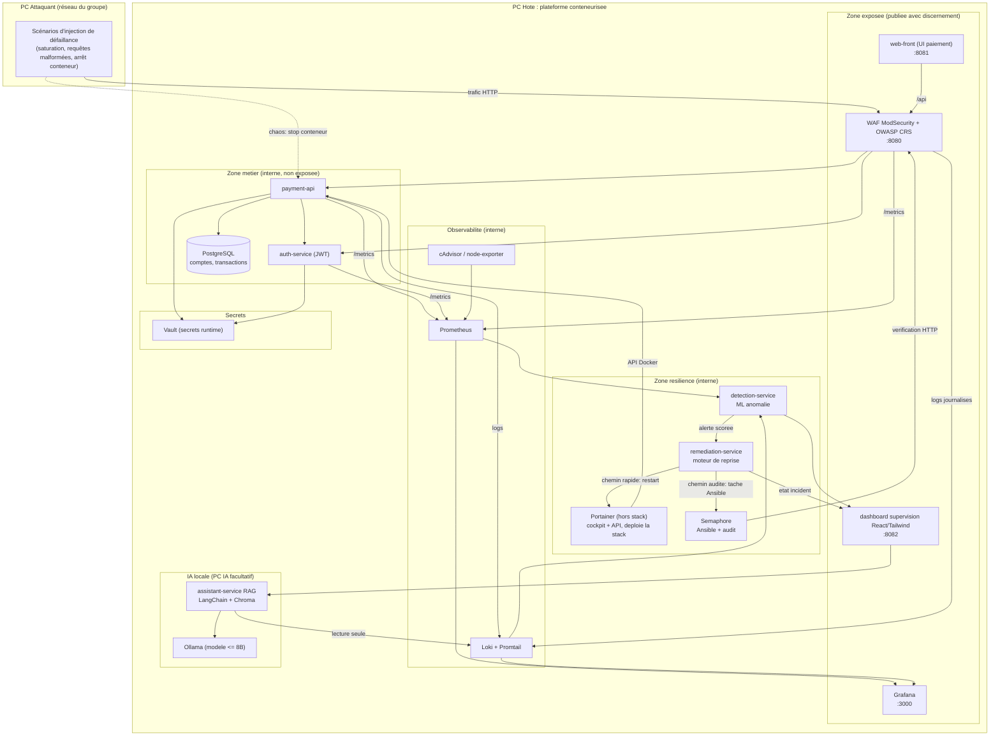
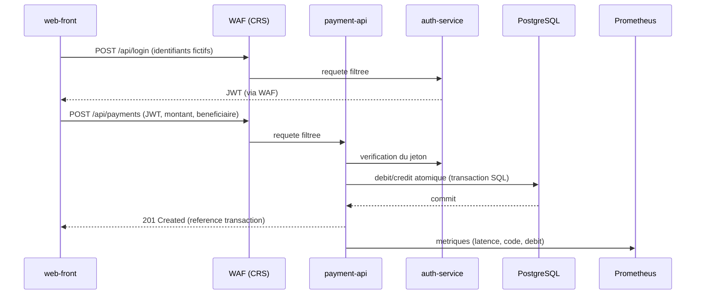
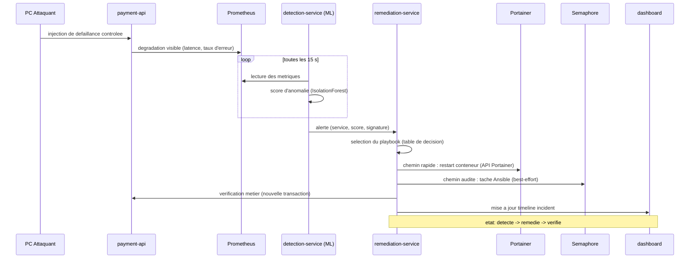

# PROJECT RESILIENCE-ALPHA : architecture de la plateforme

> Consortium Workshop2026-M2-Gn. Document technique de référence.
> Plateforme de paiement fictive "PayAlpha" et chaîne de cyber-résilience à reprise autonome.

## 1. Principe directeur

La plateforme doit démontrer une chaîne complète : un service métier critique (paiement
fictif) subit un incident de sécurité provoqué dans un environnement isolé, l'anomalie est
identifiée par un modèle de machine learning (et non par de simples seuils fixes), une
décision de remédiation est prise puis exécutée automatiquement, et le retour à un état
utilisable est prouvé par une nouvelle transaction fictive réussie. Aucune intervention
humaine corrective pendant la séquence.

Les cinq piliers du sujet sont présents et interconnectés :

| Pilier | Composants livrés | Rôle dans la chaîne |
| --- | --- | --- |
| DEV | payment-api, auth-service, web-front, remediation-service, dashboard | Fait vivre le métier et pilote la reprise |
| INFRA | Docker Compose, Ansible, Semaphore, Portainer, Prometheus, Grafana, Loki | Déploie, observe, rétablit de façon reproductible |
| IA / DATA | detection-service (ML), assistant-service (RAG local) | Identifie l'anomalie, assiste l'opérateur |
| CYBER | WAF ModSecurity, fonction SIEM, Vault + SOPS, durcissement | Éprouve et protège la plateforme |
| TRANSFORMATION | EBIOS RM, PCA/PRA, analyse NIS2/DORA | Justifie les choix et cadre la résilience |

## 2. Vue d'ensemble des composants

Les interfaces internes (base de données, Prometheus, Loki, Vault, moteur de remédiation)
ne sont pas publiées sur le réseau du groupe. Le WAF, le front de paiement, le dashboard de
supervision et Grafana exposent un port. Les cockpits d'exploitation Portainer et Semaphore
exposent aussi une interface d'administration : elles sont protégées par authentification,
restent cantonnées au réseau du groupe, et la remédiation les appelle avec un jeton scopé.
Le dashboard et le front embarquent un reverse proxy nginx : le navigateur ne dialogue
qu'avec leur origine, qui relaie vers les services internes. C'est l'application concrète de
la consigne "publier avec discernement".

## 3. Flux metier nominal (transaction reussie)

Point de contrôle métier : une transaction n'est "réussie" que si elle est committée en
base et renvoie une référence. Un conteneur qui redémarre ne prouve rien tant qu'une
nouvelle transaction de bout en bout n'a pas abouti. Le dashboard matérialise donc trois
états : avant l'incident, pendant la perturbation, après la remédiation.

## 4. Chaine de detection et de remediation autonome

La décision de remédiation suit une table explicite (signature d'incident vers action),
versionnée et auditable. Le moteur ne dispose pas d'un accès shell au système : il agit par
des API authentifiées et scopées. Le chemin rapide passe par l'API Portainer (redémarrage
du conteneur, RTO court) ; le chemin audité déclenche une tâche Ansible via l'API Semaphore,
qui laisse une trace horodatée. Aucun socket Docker brut, aucune interface d'administration
accessible aux autres composants.

## 5. Objectifs de continuite (synthese, detail dans le PCA/PRA)

| Service | Criticite | RTO vise (reprise auto) | RPO vise |
| --- | --- | --- | --- |
| payment-api | Vitale | < 120 s | 0 (transactions committees) |
| auth-service | Vitale | < 120 s | 0 |
| PostgreSQL | Vitale | < 180 s | < 5 min (sauvegarde demo) |
| dashboard / observabilite | Importante | < 300 s | sans objet |
| assistant RAG | Support | best effort | sans objet |

Ces valeurs sont des cibles de démonstration sur un périmètre maîtrisé, pas des engagements
de production. Le PCA/PRA explicite les scénarios couverts et les risques résiduels.

## 6. Choix structurants (resume)

| Decision | Option retenue | Justification | Compromis assume |
| --- | --- | --- | --- |
| Langage services | Python / FastAPI | Unifie API, ML et remediation ; rapide sur un sprint 4 jours | Moins performant que Go sous charge extreme |
| Detection | ML non supervise (IsolationForest) sur metriques | Pas de seuils en dur ; apprend un comportement normal | Sensible a la qualite du baseline |
| Acces remediation | Portainer (rapide) + Semaphore/Ansible (audite) | Reprise rapide + trace auditable ; pas de socket brut | Deux interfaces d'admin a proteger (jetons scopes) |
| Secrets | Vault (runtime) + SOPS (depot) | Separation secrets dynamiques / au repos | Vault en mode dev pour la demo |
| SIEM | Loki + Grafana alerting + regles de correlation | Compatible RAM du PC Hote (Elastic ecarte) | Correlation moins riche qu'un SIEM dedie |
| Assistant | Ollama local + LangChain + Chroma | Souverain, sans secret envoye a un tiers | Qualite limitee par un modele <= 8B |

Le détail de chaque décision, les limites constatées et ce que l'équipe ferait différemment
en contexte industriel figurent dans le dossier d'ingénierie et de gouvernance.
